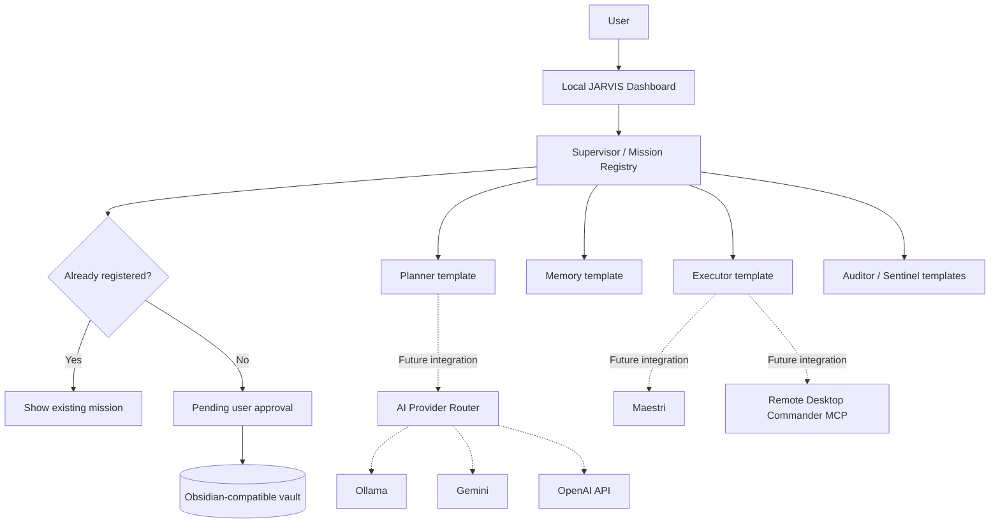

<div align="center">

# ◉ J.A.R.V.I.S.
### MULTI-AGENT ECOSYSTEM · COMMUNITY EDITION

**Your second brain. Your AI agents. Your command center.**

*Build a local-first AI workspace that remembers missions, organizes knowledge, and prepares integrations with multiple AI providers.*


**[Quick start](#-quick-start)** · **[How it works](#-how-jarvis-works)** · **[Architecture](#-architecture)** · **[Roadmap](#-roadmap)** · **[Contribute](#-join-the-community)**

</div>

---

## 🌌 The idea: from chatbots to an AI operating environment

Most AI chats start over with every task. JARVIS proposes a different approach: a persistent **knowledge vault**, a **mission log**, clearly defined **agent roles**, and a local **command center**.

Imagine telling your AI assistant:

> "Prepare a new mission, check whether it has been requested before, organize the work, and save the outcome in my knowledge base."

Instead of relying on a single conversation, the system should consult its memory, plan the work, route it to appropriate agents, request permission for consequential actions, and preserve an audit trail.

**This repository is the open-source starting point for that vision.** It is not a clone of anyone's personal vault or an unrestricted autonomous agent.

## 🧠 Two interfaces, one ecosystem

### ◉ JARVIS Command Center

A dark, futuristic, cyan-accented dashboard inspired by science-fiction command centers. The current runnable dashboard provides:

- A local web interface at `http://127.0.0.1:8765`
- A mission input and history view
- Agent role templates
- Mission creation with an approval-required state
- Duplicate detection for identical mission descriptions

**Visual direction:** concentric HUD rings, mission status panels, subtle neon effects and responsive navigation. The advanced visual design is a goal; the current dashboard is a simpler MVP.

### ✦ Neural Explorer — planned

A future interactive graph will help explore how knowledge connects:

| Node type | Meaning |
| --- | --- |
| 🟢 Projects | Related workspaces and initiatives |
| 🔵 Tools | Applications, MCP servers and integrations |
| 🟠 Memory | Notes, decisions and mission history |
| 🟣 Areas | Domains of knowledge |
| 🟡 Skills | Reusable workflows and instructions |
| 🔷 Agents | Supervisor, Planner, Executor, Memory, Auditor and Sentinel |

Planned modes include force graph, radial layout, rings, filters, search, node inspection and relationship discovery. **This graph is not implemented in the current release.**

> The screenshots that inspired the design are not included because they come from a private environment. Contributors are welcome to create original, synthetic demo visuals.

## ⚙️ How JARVIS works



**Current workflow:** a user submits a mission in the dashboard. JARVIS normalizes its description, checks a SHA-256 digest against existing entries, stores new missions locally, and creates a Markdown note in the vault. New missions remain `pending_approval`; they are **not autonomously executed**.

**Future workflow:** after explicit approval, an orchestrator could delegate to specialized agents, choose an AI provider, run authorized tools and store validated results.

## 🧩 Components and actual status

| Component | Purpose | Status |
| --- | --- | --- |
| Local command dashboard | Create and inspect missions | ✅ Implemented |
| Mission history | JSON registry and Markdown notes | ✅ Implemented |
| Duplicate detection | Avoid identical mission registrations | ✅ Implemented |
| Obsidian vault bootstrap | Create an isolated starter vault | ✅ Implemented |
| Agent templates | Define six agent responsibilities | ✅ Implemented as Markdown templates |
| Ollama | Run local language models | 📖 Setup guide; not connected to dashboard |
| Gemini | Cloud model provider | 📖 Setup guide; API integration pending |
| OpenAI | Cloud model provider | 📖 Setup guide; API integration pending |
| Maestri | Agent orchestration | 📖 Integration guide; automation pending |
| Remote Desktop Commander MCP | Authorized remote computer operations | 📖 Setup guide; pairing pending |
| Neural Explorer | Interactive knowledge graph | 🧪 Planned |
| One-click dependency installer | Install every third-party component | 🧪 Planned |

**No false claims:** the agent templates are not six independent running AI processes. External providers, MCP pairing and Maestri need separate setup and development. A ChatGPT subscription is not equivalent to OpenAI API credits.

## 🚀 Quick start

**Requirements:** Windows 10/11, Python 3.10 or newer, PowerShell, and optionally Obsidian.

1. Download this repository with **Code → Download ZIP** and extract it.
2. Open PowerShell in the extracted folder.
3. Review the installation script, then run:

```powershell
powershell -NoProfile -ExecutionPolicy Bypass -File .\install.ps1
```

4. Start the local dashboard:

```powershell
powershell -NoProfile -ExecutionPolicy Bypass -File .\start.ps1
```

5. Open **http://127.0.0.1:8765** and submit a fictional mission.
6. In Obsidian, choose **Open folder as vault**, selecting `%USERPROFILE%\JarvisCommunity\ObsidianVault`.

The installer initializes the community vault. It **does not** install Obsidian, Maestri, Ollama or configure remote MCP access automatically.

### Test without PowerShell

```bash
python jarvis.py init
python jarvis.py mission "Write a demo project plan"
python jarvis.py serve
```

To run the included tests:

```bash
python -m unittest discover -s tests -v
```

## 🖥️ Multi-account AI workspaces via Remote Desktop Commander

JARVIS is designed to coordinate **user-authorized desktop sessions** across tools such as **Google Antigravity, Claude, Codex, ChatGPT and other compatible desktop or browser applications**.

### Why use desktop interaction instead of an API?

A traditional API integration sends requests to a provider's API and may incur separate token-based charges. With a desktop-control MCP server, an approved agent can instead interact with the **existing graphical interface** of a tool that the user has already signed into. This can avoid **additional API charges for that particular interaction** when no API request is made by the JARVIS integration.

**It does not mean free or unlimited AI.** Provider subscriptions, app usage limits, message quotas, fair-use rules and service-specific charges still apply. Remote Desktop Commander is a computer-control transport, not a free inference provider.

### Multiple accounts and profiles

Users may maintain separate, legitimately owned or authorized accounts and browser profiles for different workspaces, subject to each provider's terms. JARVIS should:

1. Let users explicitly select an authorized account/profile and provider.
2. Keep credentials and sessions managed by the provider's normal login flow.
3. Request permission before sensitive desktop operations.
4. Log the chosen tool and outcome without storing passwords or session tokens.
5. Respect provider limits and never automatically rotate accounts to evade quotas or restrictions.

**Implementation status:** this is a proposed integration pattern, **not a currently working account switcher or automatic multi-provider orchestration feature**. MCP pairing and actual UI automation must be configured and tested separately.

See [Remote Desktop Commander MCP](docs/REMOTE_DESKTOP.md) and [Security](docs/SEGURANCA.md).

## 🛡️ Privacy by design

This public project includes **no personal memories, real client records, private project files, account credentials, authentication tokens, pairing links or private Obsidian vaults**.

- The web server listens only on `127.0.0.1`.
- A new, isolated vault is created under the current user's home directory.
- Mission registration does not run shell commands or send external messages.
- Do not expose the dashboard to the public internet.
- Remote computer control must require explicit authorization.
- Keep `.env`, secrets and private data out of Git.

Read [Security](docs/SEGURANCA.md) before adding integrations.

## 🗺️ Roadmap

- [x] Public community repository and MIT license
- [x] Local mission dashboard
- [x] Obsidian-compatible vault generator
- [x] Agent role templates and duplicate mission check
- [ ] Polished HUD dashboard with accessible UI
- [ ] Neural Explorer graph with synthetic demo dataset
- [ ] Provider adapters for Ollama, Gemini and OpenAI
- [ ] Approval-driven agent orchestrator
- [ ] Verified Maestri integration
- [ ] Remote Desktop Commander MCP configuration wizard
- [ ] One-place Windows installer with dependency checks and safe rollback
- [ ] End-to-end integration tests and release builds
- [ ] Portuguese and English documentation

## 🤝 Join the community

**Want to help build a practical open-source AI command center?**

You can contribute by building the graph UI, writing provider adapters, testing Windows installation, improving Obsidian workflows, reviewing security or translating documentation.

1. ⭐ **Star** the repository if the idea is useful.
2. 🍴 **Fork** it and experiment with your own configuration.
3. 🐛 Open an **Issue** with reproducible bugs or feature ideas.
4. 🔧 Send a **Pull Request** with a focused improvement and tests.
5. 💬 Share architecture ideas and screenshots made with **synthetic data**.

See [CONTRIBUTING.md](CONTRIBUTING.md). First-time contributors are welcome. We especially value **honest, verifiable integrations** over flashy demos that cannot be reproduced.

### Suggested first contributions

- Design a responsive sci-fi HUD without requiring private assets.
- Create a standalone interactive graph using sample Markdown notes.
- Add Ollama model selection with a health check and timeout.
- Build a secure MCP setup wizard with explicit consent.
- Add an English/Portuguese language toggle.

## 📚 Documentation

- [Architecture](docs/ARQUITETURA.md)
- [AI providers](docs/PROVEDORES.md)
- [Maestri integration](docs/MAESTRI.md)
- [Remote Desktop Commander MCP](docs/REMOTE_DESKTOP.md)
- [Security](docs/SEGURANCA.md)

## 📜 License and attribution

MIT License. This is an independent community project, not affiliated with or endorsed by Obsidian, Maestri, Ollama, Google, OpenAI or Desktop Commander. JARVIS-inspired visual terminology is used descriptively; no third-party franchise assets are distributed.

---

<div align="center">

### Your knowledge. Your agents. Your command center.

**Start small. Build openly. Make every mission traceable.**

</div>
